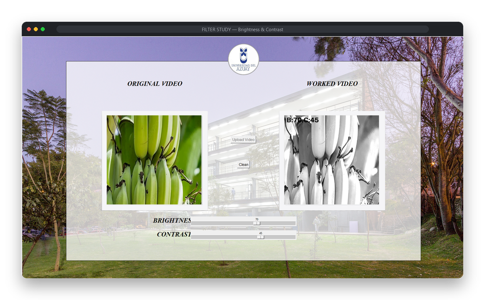

# Brightness & Contrast 🎞️

Desktop tool for **real-time video processing** built with **Python**, **OpenCV** and
**Tkinter**. You load a video and see the original and the processed version side by side,
adjusting **brightness** and **contrast** with sliders while it plays. Built for the Digital Signal Processing course of the Electronics Engineering
program at Universidad del Azuay.




## Features

<p align="center"></p>


- Load any video file from disk
- Side-by-side view: original vs. processed video
- Brightness and contrast sliders applied frame by frame
- Simple two-screen interface (welcome screen and workspace)

## Tech stack

- Python · OpenCV · NumPy · Pillow · imutils
- Tkinter for the GUI

## Getting started

```bash
pip install -r requirements.txt
python BrightnessContrast.py
```

---

**Oscar Cuenca** · [LinkedIn](https://www.linkedin.com/in/ocuenca-moreno/)
