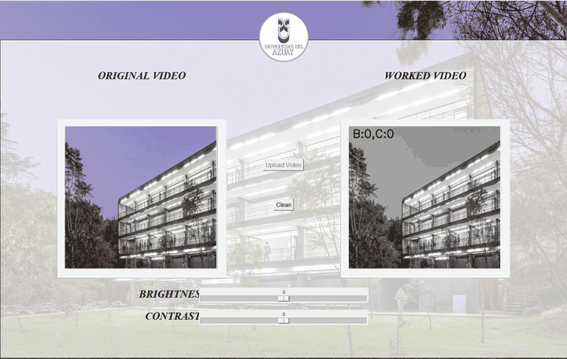
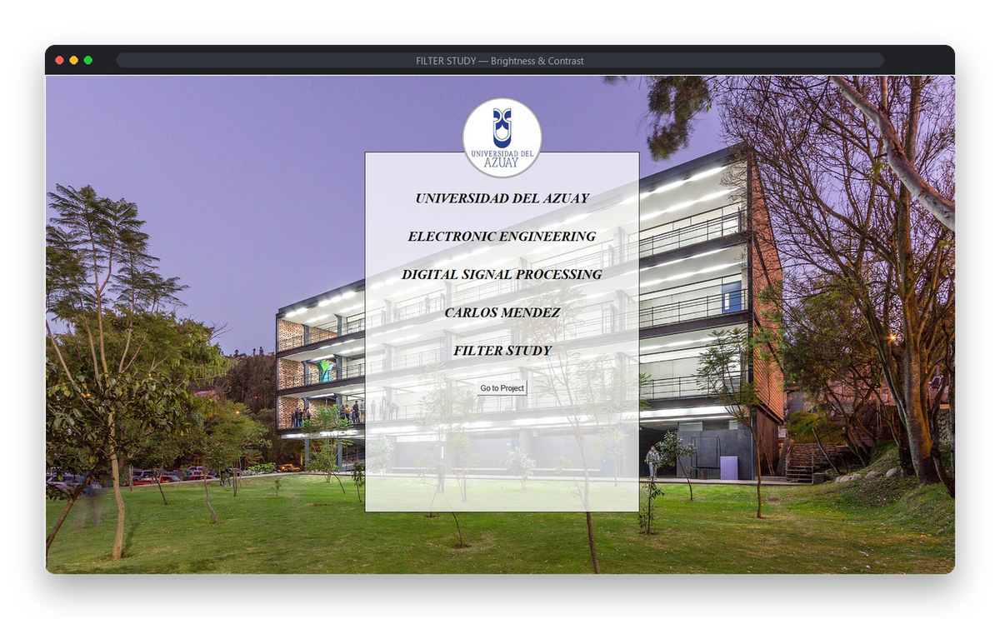

# Brightness & Contrast 🎞️

Desktop tool for **real-time video processing** built with **Python**, **OpenCV** and
**Tkinter**. You load a video and see the original and the processed version side by side,
adjusting **brightness** and **contrast** with sliders while it plays. Built for the Digital Signal Processing course of the Electronics Engineering
program at Universidad del Azuay.


<p align="center"></p>

## How it works

Each frame is read with OpenCV, converted to greyscale for the processed view and passed through two linear
operations, `out = α·in + β`, applied with `cv2.addWeighted`:

- **Brightness** `b` (−255 to 255) remaps the range: a positive value lifts the blacks to `b`
  (`α = (255 − b) / 255`, `β = b`); a negative value lowers the whites to `255 + b` (`α = (255 + b) / 255`, `β = 0`).
- **Contrast** `c` (−127 to 127) stretches or compresses around mid-grey:
  `α = 131·(c + 127) / (127·(131 − c))`, `β = 127·(1 − α)`.

The processed frame updates as soon as a slider moves.

## Features

- Load any video file from disk
- Side-by-side view: original vs. processed video
- Brightness and contrast sliders applied frame by frame
- Simple two-screen interface (welcome screen and workspace)

| Welcome screen | Workspace |
|---|---|
|  |  |

## Tech stack

- Python · OpenCV · NumPy · Pillow · imutils
- Tkinter for the GUI

## Getting started

```bash
pip install -r requirements.txt
python BrightnessContrast.py
```

## License

[MIT](LICENSE) © Oscar Cuenca · [LinkedIn](https://www.linkedin.com/in/ocuenca-moreno/)
